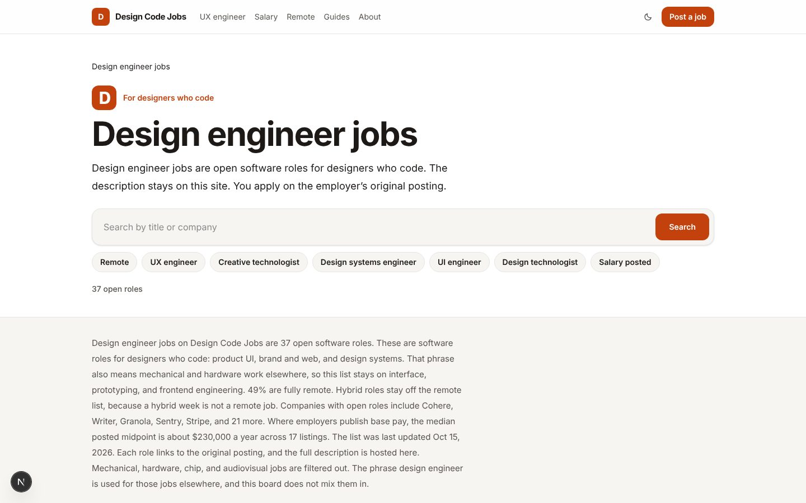
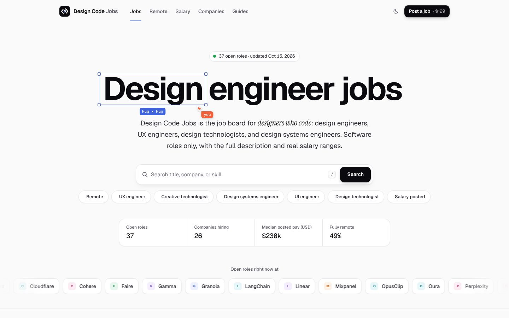
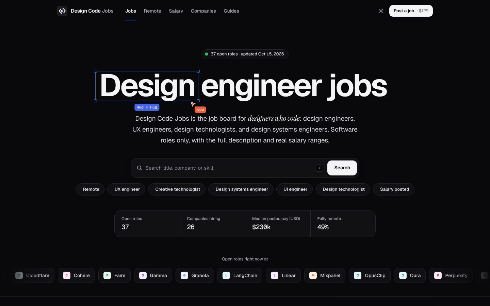
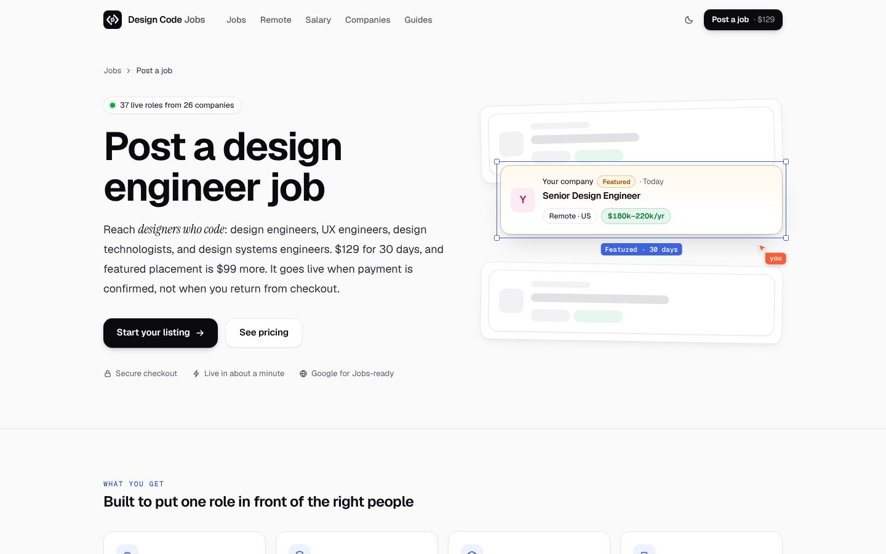
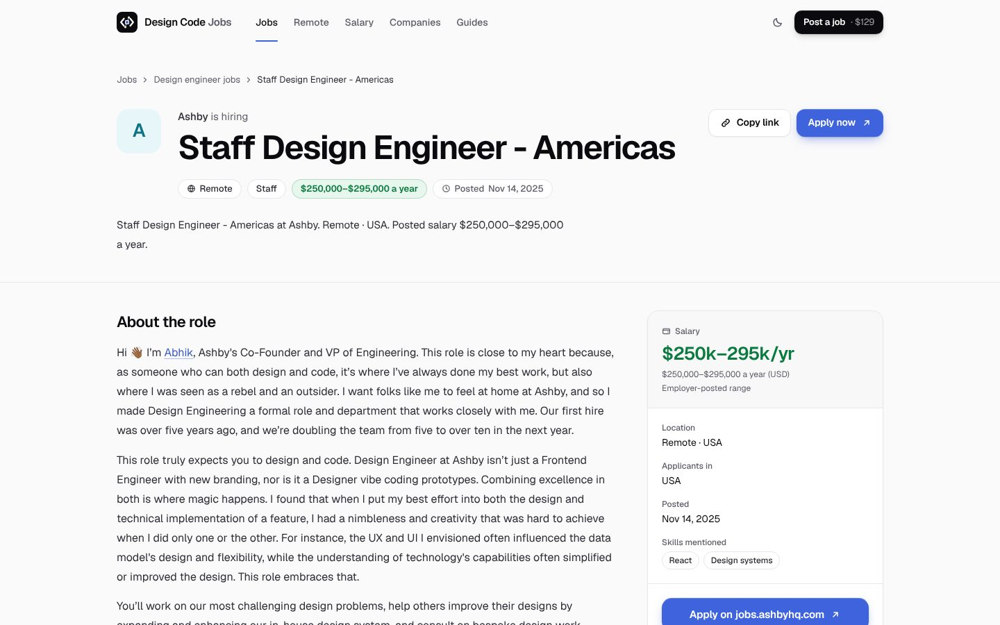
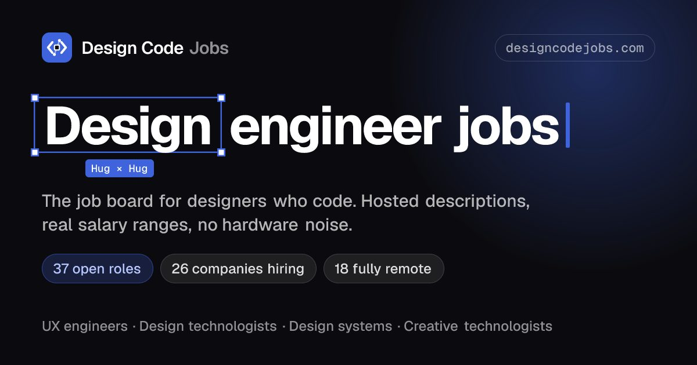

# Design Code Jobs site analysis

Date: 2026-10-15. Scope: designcodejobs.com as live before the redesign, plus the redesigned build on branch `claude/website-design-overhaul-fj7oa6` (commit `6efef43`).

## How this was measured

| Check | Tool | Details |
| --- | --- | --- |
| Technical SEO crawl | OpenSEO site audit | 141 pages crawled from the live site, Lighthouse on 20 of them |
| Google rankings | OpenSEO live SERPs | 5 keywords, Google US, desktop, top 20 results |
| AI answer engines (AEO) | OpenSEO prompt explorer | 2 prompts asked to ChatGPT, Claude, and Perplexity with web search, US. Gemini was not run (it does not accept a country setting). |
| Performance after redesign | Lighthouse 12, mobile | Production build of the new design, run locally |

AI answers change from run to run. Treat the AEO results as a snapshot, not a ranking.

## Summary

| | Result |
| --- | --- |
| Google top 20 for the 5 core keywords | Design Code Jobs appears for **0 of 5** |
| AI answers that mention Design Code Jobs | **0 of 6** (3 engines × 2 prompts) |
| Audit warnings on the live site | **20 warnings, 0 critical**. All 20 are fixed in the redesign branch. |
| Lighthouse after redesign (mobile) | Performance 95–97, accessibility 100, SEO 92–100, layout shift 0 |

The site is technically sound. The problem is visibility: Google and the AI engines don't know the site yet, and the pages that would rank for role keywords are mostly `noindex` until they hold 5 open roles.

## Google search

| Keyword | #1 result | Design Code Jobs | What ranks |
| --- | --- | --- | --- |
| design engineer jobs | designengineer.io | Not in top 20 | One niche board, then Indeed, Built In, LinkedIn, ZipRecruiter, mostly mechanical roles |
| ux engineer jobs | Indeed (Baltimore) | Not in top 20 | Indeed, ZipRecruiter, and LinkedIn city pages |
| design engineer salary | Indeed salaries | Not in top 20 | Indeed, Glassdoor, levels.fyi, ZipRecruiter, Salary.com. All mechanical data. An AI Overview sits on top. |
| creative technologist jobs | Indeed (Colorado) | Not in top 20 | Indeed and ZipRecruiter city pages, HiringCafe, Teal |
| design engineer job board | iHireEngineering | Not in top 20 | Mechanical boards, plus uicoach.io at #8 with a live count in its title ("Design Engineer Jobs in United States (41 open)") |

What this says:

- Only one niche software board ranks for the head term (designengineer.io). The rest of page one belongs to the big aggregators.
- "Design engineer salary" is entirely mechanical-engineering data. The software salary angle is still open, as the SEO plan predicted.
- A live count in the title ("41 open") is a pattern that ranks for the board query.

## AI answer engines (AEO)

Prompt 1: "What are the best job boards for finding design engineer jobs (software designers who code, UX engineers, design technologists)?"

Prompt 2: "Where should I post a job listing to hire a design engineer who can design and code front-end UI?"

| Engine | Prompt 1 recommends | Prompt 2 recommends | Mentions us |
| --- | --- | --- | --- |
| ChatGPT | LinkedIn, Wellfound, YC Work at a Startup, Built In, Dribbble, Authentic Jobs, UX Jobs Board, HN Who is Hiring | LinkedIn, Wellfound, Dribbble or AIGA | No |
| Claude | Dribbble, If You Could Jobs, UX Jobs Board, Authentic Jobs, Uxcel, We Work Remotely, LinkedIn, Wellfound | IxDA, Authentic Jobs, Smashing Jobs, We Work Remotely, LinkedIn, Upwork | No |
| Perplexity | **designengjobs.com first** ("the most directly targeted board"), then LinkedIn, Wellfound, YC, Built In | **designengjobs.com first**, then LinkedIn, Wellfound, YC, Dribbble | No |

Sources the engines cited most: adplist.org, magier.com, uxcel.com, careerfoundry.com, blog.uxtweak.com, sidequestboard.app, work-club.com. These are all "best design job boards" listicles.

What this says:

- A direct competitor, designengjobs.com, is not in the SEO plan's competitor list and already wins Perplexity for both prompts.
- Perplexity quoted that site's own one-line description of itself. A clear, quotable self-description on the home page is part of how a board gets picked.
- ChatGPT and Claude build their lists from listicles. Getting into those articles is the main way into those answers.

## Technical audit of the live site

| Issue | Severity | Count | Where | Status |
| --- | --- | --- | --- | --- |
| Duplicate title | Warning | 6 | `/companies/vitraz` used the home title; two Linear "Design Engineer (Web & Brand)" jobs; `/roles/design-engineer` and its `?page=2` | Fixed |
| Duplicate meta description | Warning | 4 | Same pages as above | Fixed |
| Orphan page | Warning | 6 | `/skills/figma`, `/skills/design-systems`, `/skills/motion`, `/skills/react`, `/seniority/staff`, `/reports/2026-10` | Fixed |
| Thin content | Warning | 4 | `/companies` (140 words), `/salary/ux-engineer`, `/salary/creative-technologist`, `/reports/2026-10` | Fixed |
| Heading levels skip | Info | 4 | Job pages where the employer description starts at h3 or h4 | Fixed |
| Meta description too short | Info | 4 | Job pages with no salary ("Staff Design Engineer at Mixpanel. Remote. Salary not posted.") | Fixed |
| Page is noindex | Info | 70 | Filtered URLs and hub pages below the 5-role threshold, including `/roles/ux-engineer` | By design. See recommendations. |
| Canonicalized to another URL | Info | 27 | Filter query strings that point at their parent | By design |
| Slow server response | Info | 1 | `/?pay=1&role=ux-engineer` at 1.8 s | Open, low priority |

A bug the audit pointed to but did not name: skill, seniority, region, role-remote, and company pages rendered "Next" links but ignored `?page=`, so page 2 repeated page 1. `/skills/react?page=2` now shows roles 26–33.

## What changed in the redesign

Design:

- New brand mark: a `</>` code tag whose slash is a pen-tool handle with a selected anchor point. One SVG source produces the favicon, app icons, manifest icon, and the Organization logo.
- New design system: ink and indigo tokens for light and dark, Geist and Geist Mono, green salary chips, and AA contrast on every text token.
- Home: a hero with a Figma-style selection frame on the H1, a live role count, `/` to search, filter chips, a stats strip, and a scrolling strip of hiring companies.
- Fully clickable job cards with hover motion, and a sticky sidebar with the employer offer, alerts, and roles with counts.
- Job page: a sticky apply card with a source note, a copy-link button, and a mobile apply bar.
- Post a job is now a sales page: value, pricing cards that preselect the plan, how it works, and a form with a live listing preview and an order summary.
- New Open Graph images for home (live counts), jobs, and guides.

SEO and AEO:

- Fixed every audit warning above.
- `/llms.txt` with live counts for AI assistants. `robots.txt` names the AI crawlers as allowed.
- Richer Organization and WebSite JSON-LD, plus published and updated dates on the guides.
- A quotable one-sentence description of the board on the home page, the about page, and in `llms.txt`.
- An employer FAQ entry that answers "Where should I post a design engineer job?".

## Screenshots

Before:

After:

## Lighthouse after the redesign (mobile)

| Page | Performance | Accessibility | Best practices | SEO | LCP | CLS |
| --- | --- | --- | --- | --- | --- | --- |
| Home | 95 | 100 | 96 | 100 | 2.2 s | 0 |
| Post a job | 95 | 100 | 100 | 100 | 2.5 s | 0 |
| Job page | 95 | 100 | 96 | 92 | 2.6 s | 0 |
| Salary | 97 | 100 | 100 | 100 | 2.5 s | 0 |

The best-practices points lost on home and the job page come from company favicon requests that the test sandbox blocked; they load in production. The job page SEO score loses points for "here" links inside the employer's own description. Post a job first measured 97 for accessibility; after fixing the one contrast issue it flagged, it measures 100.

The old design's Lighthouse scores were not exported by the audit tool, so there is no before column.

## Recommendations, in priority order

1. **Get into the listicles the AI engines cite.** Ask adplist.org, magier.com, uxcel.com, careerfoundry.com, uxtweak.com, sidequestboard.app, and work-club.com to add Design Code Jobs to their "best design job boards" articles. This is the biggest AEO lever.
2. **Publish a "best job boards for design engineers" guide.** It should be an honest comparison that includes competitors. AI engines quote pages like this, and it targets the employer question directly.
3. **Decide the index threshold for role pages.** `/roles/ux-engineer` and most role hubs are `noindex` until they have 5 open roles. Lowering it to 3, or indexing role pages that carry enough evergreen text, would let the role keywords start ranking.
4. **Add a public support email.** Buyers look for one before paying, and the about page still says it is not configured.
5. **After deploy, resubmit.** Submit the sitemap in Search Console and Bing, run `npm run indexnow`, and re-run the AI prompts in OpenSEO in 2–4 weeks to see if anything moved.
6. **Self-host company logos.** Google favicons vary in quality. Uploaded logos would make cards and the hiring strip look sharper.
7. **Archive the monthly report.** `/reports/2026-10` is live-only. Freezing each month makes it a citable data asset for journalists and newsletters.
